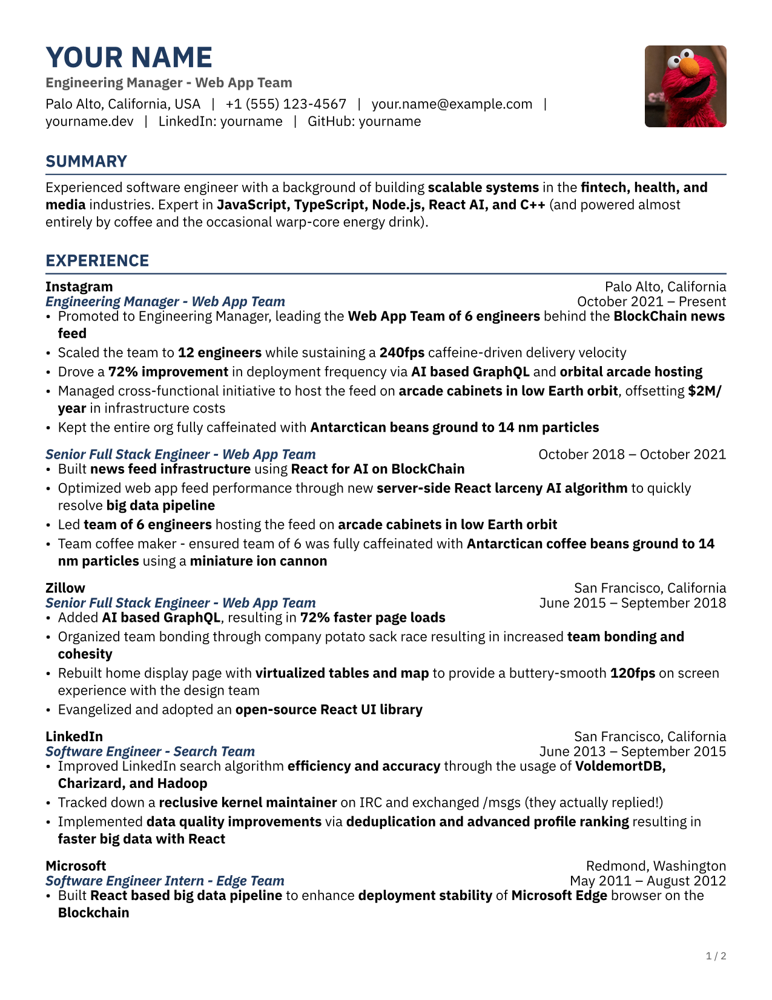
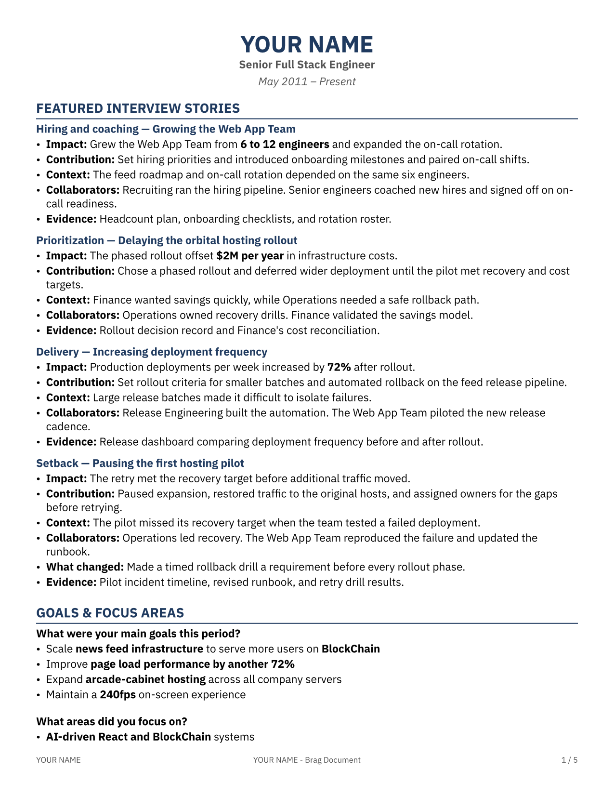

# Resume & Brag Document Template

A single-column resume and a brag document in Typst. The fictional samples show a two-page resume and a five-page career archive with interview stories, career history, feedback, projects, and metrics. Both layouts support an optional photo.

 

## Dependencies

Install and start Docker with Docker Compose v2 or later. Docker Desktop includes Compose on Windows and macOS. Install [Task](https://taskfile.dev/installation/) for the shortcuts below. Compose runs Typst 0.15.1 and loads the bundled IBM Plex Sans fonts.

## Edit and build

1. In `src/resume.typ`, replace the contact details, summary, experience, skills, and education. Match the headline to your target role and lead with recent, relevant outcomes. Add projects when they demonstrate work beyond your experience bullets.
2. In `src/bragdoc.typ`, select three to five featured interview stories for the role you want. Capture the context, your decision, collaborators' responsibilities, the result, and how you verified it. Include a setback and what changed afterward. Keep sensitive details and supporting evidence out of public commits and screenshots.
3. Edit values inside quotes. Use `*bold*` to emphasize a result and `**` for a literal asterisk. For a clickable profile, supply its URL. The network and username provide the visible label.
4. From the repository root, run:

   ```sh
   task compile           # Write src/resume.pdf and src/bragdoc.pdf
   task compile-resume    # Compile only the resume
   task compile-bragdoc   # Compile only the brag document
   task dev              # Watch both documents
   task dev-resume        # Watch only the resume
   task dev-bragdoc       # Watch only the brag document
   task previews          # Refresh the checked-in first-page screenshots
   ```

   Without Task, use Compose directly:

   ```sh
   docker compose run --rm typst compile src/resume.typ src/resume.pdf
   docker compose run --rm typst compile src/bragdoc.typ src/bragdoc.pdf
   ```

   The `task dev` commands watch files on the host and compile in Docker. Press Ctrl+C to stop watching.

5. Check the exported resume before submitting it. Copy its text into a plain-text editor and check the order of contact details, roles, dates, and bullets. Follow the employer's requested file format.

PDF builds include every page. The PNG previews show the first page of each example. To customize section layouts, see the renderers and entry helpers in `src/functions.typ`.

### Add a photo

1. Place your JPG or PNG in `src/`.
2. In either document, set `#let photo = "headshot.jpg"` to match the filename. The image is cropped to a square beside the name and title.
3. Rebuild the PDF. Leave `photo` as `""` for the default centered header.

## GitHub releases

Pushes to `master` create versioned resume PDF releases after both documents compile. Pull requests targeting `master` or `dev` and manual workflow runs check both PDFs using the same Compose image as local builds. Put `[skip release]` in the head commit message to skip publication for that push.

This upstream repository publishes both fictional demo PDFs. Copies and forks attach only the resume by default. A public repository exposes committed source files and previews regardless of which PDFs the release attaches.

### Opt in to brag document releases

1. In your GitHub repository, go to **Settings → Secrets and variables → Actions → Variables**.
2. Select **New repository variable**. Set the name to `PUBLISH_BRAGDOC` and the value to `true`.
3. Push a new commit to `master` and check that the new release includes both PDFs.

Set the variable to `false` to disable future brag document attachments, including in the upstream repository. Existing releases keep their assets until you remove them.

## Contributing and licensing

See the [contribution guide](.github/CONTRIBUTING.md) and [code of conduct](.github/CODE_OF_CONDUCT.md). Dependabot checks the GitHub Actions and Docker Compose dependencies weekly.

The template code and documentation use the [MIT License](LICENSE). The bundled IBM Plex Sans fonts use the [SIL Open Font License 1.1](src/fonts/OFL.txt). The supplied Elmo demo image and previews or PDFs that include it have no verified redistribution license in this repository. Before publishing those files, confirm you have the necessary rights or replace the demo photo with one you can redistribute.
